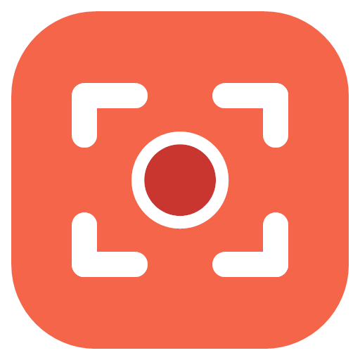
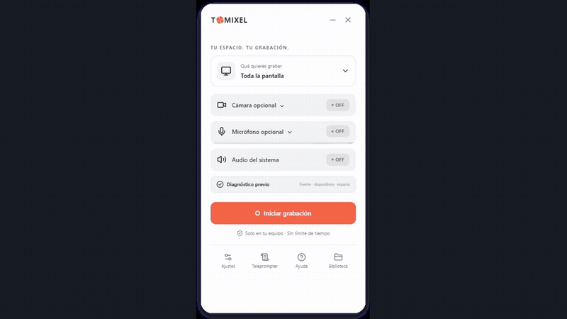
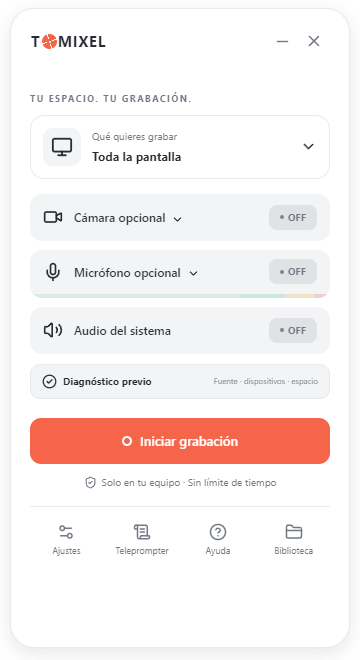
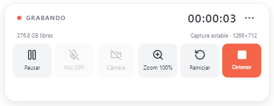
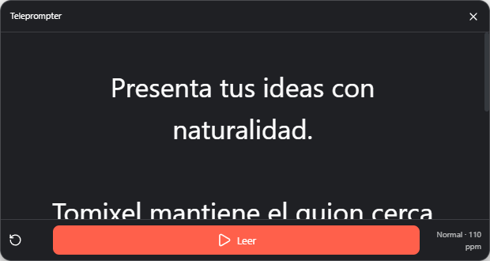
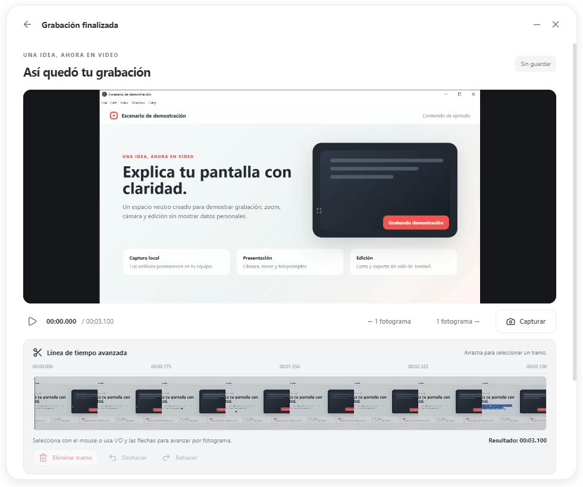
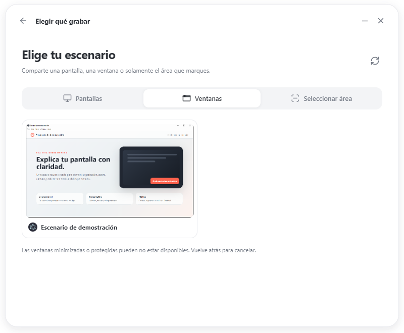

<div align="center">
  

  # Tomixel

  **Graba, presenta y edita tu pantalla sin salir de tu equipo.**

  [](https://github.com/yordy-dev/tomixel/releases/latest)
  
  [](LICENSE)

  [**Descargar Tomixel**](https://github.com/yordy-dev/tomixel/releases/latest) · [Ver cambios](CHANGELOG.md) · [Reportar un problema](https://github.com/yordy-dev/tomixel/issues/new)
</div>



<div align="center">
  <a href="docs/media/tomixel-demo.mp4">Ver demostración completa en video</a>
</div>

## ¿Qué es Tomixel?

Tomixel es una grabadora de pantalla local para Windows. Reúne captura, cámara, audio, teleprompter y edición en una interfaz compacta, sin exigir una cuenta ni subir tus grabaciones a la nube.

## ¿Para qué puedes usarlo?

- **Clases y tutoriales:** explica una aplicación mientras muestras tu cámara y acercas las partes importantes.
- **Presentaciones y monólogos:** lee tu guion con el teleprompter sin que aparezca en el resultado.
- **Demostraciones de productos:** graba un flujo completo y elimina los fragmentos innecesarios antes de exportarlo.
- **Soporte y reportes:** registra un problema, selecciona solo el área necesaria y comparte un MP4 claro.
- **Contenido para redes o trabajo:** combina pantalla, voz y cámara sin depender de una plataforma en la nube.

## Así se ve Tomixel

| Preparar la grabación | Controlar la grabación |
| --- | --- |
|  |  |
| **Teleprompter protegido** | **Editor integrado** |
|  |  |

## Cómo se usa

1. **Elige qué grabar.** Selecciona la pantalla completa, una ventana o un área concreta.
2. **Revisa tu equipo.** Confirma resolución, cámara, micrófono, audio y espacio disponible.
3. **Graba con control.** Usa la cámara, el teleprompter, el zoom y los atajos sin salir de la grabación.
4. **Corrige y entrega.** Elimina fragmentos innecesarios y exporta el resultado en MP4.



## Ventajas

| Ventaja | Qué significa para ti |
| --- | --- |
| Procesamiento local | No necesitas subir tus grabaciones para trabajar con ellas. |
| Herramientas integradas | Pantalla, cámara, audio, teleprompter y editor conviven en una sola aplicación. |
| Interfaz compacta | El controlador ocupa poco espacio mientras grabas. |
| Recuperación | Una grabación pendiente puede recuperarse después de un cierre inesperado. |
| Control visual | Puedes elegir el área, ajustar la cámara y usar zoom durante la grabación. |

## Funciones principales

### Captura

- Pantalla completa, una ventana o un área seleccionada.
- Zoom durante la grabación y atajos configurables.
- Cuenta regresiva y controlador flotante.
- Cámara circular redimensionable y reposicionable.

### Presentación y audio

- Micrófono, audio del sistema y reducción de ruido.
- Teleprompter flotante protegido para que el guion no aparezca en el video.
- Diagnóstico previo de fuente, dispositivos y espacio disponible.

### Edición y entrega

- Corte de fragmentos y exportación MP4.
- Capturas de área enviadas al portapapeles.
- Recuperación de grabaciones después de un cierre inesperado.

## Descargar y empezar

1. Descarga la [versión más reciente](https://github.com/yordy-dev/tomixel/releases/latest).
2. Ejecuta `Tomixel.Setup.1.7.23.exe` e instala la aplicación.
3. Abre Tomixel y completa el tutorial inicial.
4. Elige qué grabar, revisa el diagnóstico y pulsa **Iniciar grabación**.

> [!NOTE]
> El instalador actual no tiene firma digital. Windows puede mostrar una advertencia de editor desconocido; verifica que el archivo provenga de este repositorio y compara su SHA-256 con el publicado en la Release.

## Requisitos y compatibilidad

- Windows 10 u 11 de 64 bits.
- Cámara y micrófono opcionales.
- Espacio libre suficiente para las grabaciones temporales y exportadas.

Tomixel no ofrece actualmente versiones para macOS o Linux.

## Privacidad

Tomixel procesa y guarda las grabaciones localmente. No requiere una cuenta y no realiza una subida obligatoria a servicios externos. El repositorio excluye grabaciones, configuraciones personales, resultados de pruebas y archivos de compilación locales.

<details>
<summary><strong>Desarrollo local</strong></summary>

### Preparación

Se requiere Node.js y npm.

```bash
npm install
npm run dev
```

### Verificación

```bash
npm run typecheck
npm test
npm run test:transitions
```

### Instalador de Windows

```bash
npm run package:win
```

### Recursos del README

```bash
npm run media:readme
```

</details>

## Ayuda y contribución

Si encuentras un error, [abre una incidencia](https://github.com/yordy-dev/tomixel/issues/new) e incluye:

- Versión de Tomixel y de Windows.
- Pasos exactos para reproducir el problema.
- Resultado esperado y resultado obtenido.
- Captura o video, siempre que no exponga información privada.

Los problemas de seguridad deben seguir las indicaciones de [SECURITY.md](SECURITY.md).

## Licencia

Tomixel se distribuye bajo la [licencia MIT](LICENSE).
